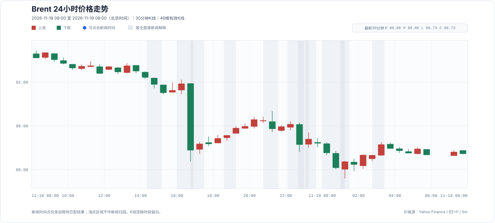

# 金十新闻事件 + Brent市场反应滚动日报（20261119 08:00）

## 今日重点（Executive Summary）

- Brent正式结算价91.95美元/桶，下降1.28%（金十03:45报道）。Yahoo BZ=F最后有效报价为07:50的88.73美元，样本变化-4.90%，高低区间93.44–87.60美元。两种数据口径差异显著，尚未确认差异原因。
- 23:30 EIA商业原油库存增加338万桶，市场预期减少50万桶，偏空库存意外与夜间承压方向一致。但23:05起跌在数据之前，库存只能解释后续压力，不能解释全天跌势。
- 16:00–16:55下跌3.00%为最大跌段。同期地缘、制裁及网络攻击新闻缺少充分的即时因果证据，保留解释不足。
- ADNOC确认船舶遇袭及人员伤亡，构成海峡运输风险；Equinor表示网络攻击未影响生产，不能据此推断实际减供。
- 本期覆盖1,594条原始快讯、270根五分钟K线，末根时点07:50。ISW采用11月17日更新，11月18日版官方发布晚于本期截止点。

## 今日 Brent 价格预测

- 预测日期：2026-11-19
- 当前 Brent 收盘价：88.76 美元/桶
- 选用模型：ARIMA
- 预测价格：88.87 美元/桶
- 预测涨跌幅：+0.13%
- 预测方向：上涨
- 历史 Direction Accuracy：47.70%
- 历史 Balanced Accuracy：31.95%
- 历史 MAE / RMSE：0.0222 / 0.0312
- 历史 OOS 样本：283
- 数据边界：仅使用历史价格数据，不使用任何新闻或非价格输入。

> Price Layer 当前选择 ARIMA 作为历史样本外表现最好的模型，预测下一交易日 Brent 小幅上涨，预测价格为 88.87 美元/桶，预测涨跌幅约 +0.13%。历史方向准确率47.70%、平衡准确率31.95%，预测幅度+0.13%较小，方向信号较弱。模型收盘价88.76属于其价格输入口径，与金十报道的结算价不同。

统计窗口：2026-11-18 08:00 至 2026-11-19 08:00（Asia/Shanghai）
新闻范围：2026-11-18 08:00 至 2026-11-19 08:00（不含截止时刻）
数据来源：金十数据快讯｜Yahoo Finance / BZ=F / 5m｜金十数据特朗普专栏｜ISW Iran Update（仅用于后续监测）

## 标的信息

- instrument_name: Brent Crude Oil Last Day Financ
- source: Yahoo Finance
- ticker: BZ=F
- contract_month: 
- contract_type: Yahoo Finance BZ=F

## 数据覆盖范围

- 价格统计窗口：2026-11-18 08:00:00 至 2026-11-19 08:00:00 北京时间（截止时刻不含）
- 实际新闻覆盖：2026-11-18 08:01:17 至 2026-11-19 07:58:11 北京时间
- 实际价格覆盖：2026-11-18 08:00:00 至 2026-11-19 07:50:00 北京时间
- Brent 5分钟K线数量：270
- 重复时间戳数量：0
- 时间戳是否有序：是
- 大于5分钟的K线缺口数量：5；最大缺口：75分钟
- 有效交易时段大于10分钟缺口数量：0；最大有效缺口：0分钟
- 正常维护休市缺口数量：1
- 是否使用部分缓存：否
- 数据状态：FORMAL；窗口覆盖校验通过。

## 本窗口Brent表现

| 最新价 | 24小时涨跌幅 | 区间最高价 | 区间最低价 |
| ---: | ---: | ---: | ---: |
| 88.73 | -4.90% | 93.44 | 87.60 |

30分钟K线，红色表示上涨、绿色表示下跌；蓝色时间点是已匹配新闻，浅灰区域表示暂无直接新闻解释。

## 本窗口Brent价格异动复盘

### 北京时间 00:00–01:15｜Brent下跌 -1.32%｜最大30分钟跌幅 -1.06%

**油价反应：**
5分钟：-0.06%｜15分钟：-0.08%｜30分钟：-0.58%｜60分钟：-1.64%｜本轮累计：-1.32%

**触发标准：**
30分钟绝对波动 >= 0.50%

**相关新闻：**
1. 新闻摘要：1. EIA报告：11月13日当周美国原油出口增加103.3万桶/日至448.8万桶/日。 2. EIA报告：11月13日当周美国国内原油产量增加1.9万桶至1403.2万桶/日。 3. EIA报告：除却战略储备的商业原油库存增...
   原文链接：https://flash.jin10.com/detail/20261118233056495800
   时间关系：新闻先于价格
   信息新鲜度：新增事实
   传导路径：直接涉及原油/能源供应、运输、制裁、库存或产量变化；偏空：事件增加供应、恢复运输或降低风险溢价。
   反应状态：UNCONFIRMED
   状态说明：已有部分价格数据，但暂时无法确认价格反应。
   归因判断：暂无法确认
   置信度：低

**市场解读：**
已有部分价格数据，但暂时无法确认价格反应。

## 价格异动但新闻解释不足

本窗口有10段显著价格异动尚无正式新闻解释。

### 北京时间 14:20–15:10｜Brent下跌 -0.90%

**油价反应：**
5分钟：-0.19%｜15分钟：-0.30%｜30分钟：-0.66%｜60分钟：-0.93%｜本轮累计：-0.90%

**说明：**
未找到足以可靠解释该段波动的金十新闻；以下仅为同期相关背景，不作价格归因。

**相关背景（未作价格归因）：**
1. 新闻摘要：阿布扎比国家石油公司：在霍尔木兹海峡发生的袭击中，一名船员失踪，11人受伤。
   发布时间：2026-11-18 14:36 北京时间
   原文链接：https://flash.jin10.com/detail/20261118143624411800
   时间关系：同期发生
   信息新鲜度：新增事实
   传导路径：直接涉及原油/能源供应、运输、制裁、库存或产量变化
   对应价格异动：北京时间 14:20–15:10
   归因判断：相关背景，未作价格归因
   置信度：低

2. 新闻摘要：阿联酋阿布扎比国家石油公司物流与服务部门确认，其一艘船舶于2026年11月17日晚间在通过霍尔木兹海峡时遭到袭击。目前仍有1名船员失联，相关搜救行动正在与有关当局协调进行。其余所有船员均已安全撤离该船。共有11名船员受伤，其中需...
   发布时间：2026-11-18 14:36 北京时间
   原文链接：https://flash.jin10.com/detail/20261118143634888800
   时间关系：同期发生
   信息新鲜度：新增事实
   传导路径：直接涉及原油/能源供应、运输、制裁、库存或产量变化
   对应价格异动：北京时间 14:20–15:10
   归因判断：相关背景，未作价格归因
   置信度：低

**可能原因：**
美元、美债、美国市场开盘、资金流、技术交易、外盘消息、新闻抓取缺口或非金十来源事件。

归因判断：暂无法确认
置信度：低

### 北京时间 16:00–16:55｜Brent下跌 -3.00%

**油价反应：**
5分钟：+0.17%｜15分钟：+0.11%｜30分钟：-2.85%｜60分钟：-3.07%｜本轮累计：-3.00%

**说明：**
未找到足以可靠解释该段波动的金十新闻；以下仅为同期相关背景，不作价格归因。

**相关背景（未作价格归因）：**
1. 新闻摘要：据知情人士透露，作为新一轮制裁方案的一部分，欧盟将提议禁止俄罗斯前作战人员进入欧盟境内。签证禁令将成为欧盟针对俄罗斯所实施的最新制裁方案的核心内容。知情人士称，欧盟委员会计划提出的其他限制措施还包括：针对多家银行、数字货币服务提...
   发布时间：2026-11-18 16:47 北京时间
   原文链接：https://flash.jin10.com/detail/20261118164738785800
   时间关系：同期发生
   信息新鲜度：新增事实
   传导路径：直接涉及原油/能源供应、运输、制裁、库存或产量变化
   对应价格异动：北京时间 16:00–16:55
   归因判断：相关背景，未作价格归因
   置信度：低

2. 新闻摘要：据外媒报道，在沙特与胡塞武装最新一轮冲突升级中，由沙特领导的也门联军对胡塞武装发动了大规模袭击。联军发言人周三发文称，沙特支持的部队袭击了也门首都萨那、红海沿岸的荷台达，以及阿姆兰省和萨达省的60个军事目标，旨在“削弱胡塞武装的...
   发布时间：2026-11-18 15:46 北京时间
   原文链接：https://flash.jin10.com/detail/20261118154636606800
   时间关系：新闻先于价格
   信息新鲜度：新增事实
   传导路径：直接涉及原油/能源供应、运输、制裁、库存或产量变化
   对应价格异动：北京时间 16:00–16:55
   归因判断：相关背景，未作价格归因
   置信度：低

**可能原因：**
美元、美债、美国市场开盘、资金流、技术交易、外盘消息、新闻抓取缺口或非金十来源事件。

归因判断：暂无法确认
置信度：低

### 北京时间 16:45–17:30｜Brent上涨 +0.87%

**油价反应：**
5分钟：+0.12%｜15分钟：+0.20%｜30分钟：+0.63%｜60分钟：+0.81%｜本轮累计：+0.87%

**说明：**
未找到足以可靠解释该段波动的金十新闻；以下仅为同期相关背景，不作价格归因。

**相关背景（未作价格归因）：**
1. 新闻摘要：挪威国家石油公司：没有迹象表明此次袭击对员工、合作伙伴或供应商造成影响，生产未受影响。
   发布时间：2026-11-18 17:11 北京时间
   原文链接：https://flash.jin10.com/detail/20261118171145880800
   时间关系：同期发生
   信息新鲜度：新增事实
   传导路径：直接涉及原油/能源供应、运输、制裁、库存或产量变化
   对应价格异动：北京时间 16:45–17:30
   归因判断：相关背景，未作价格归因
   置信度：低

2. 新闻摘要：挪威国家石油公司：正与当局合作，努力消除网络攻击影响并恢复系统。
   发布时间：2026-11-18 17:12 北京时间
   原文链接：https://flash.jin10.com/detail/20261118171208752800
   时间关系：同期发生
   信息新鲜度：新增事实
   传导路径：直接涉及能源基础设施运行变化
   对应价格异动：北京时间 16:45–17:30
   归因判断：相关背景，未作价格归因
   置信度：低

**可能原因：**
美元、美债、美国市场开盘、资金流、技术交易、外盘消息、新闻抓取缺口或非金十来源事件。

归因判断：暂无法确认
置信度：低

### 北京时间 18:35–19:15｜Brent上涨 +0.53%

**油价反应：**
5分钟：+0.08%｜15分钟：+0.02%｜30分钟：+0.51%｜60分钟：+0.58%｜本轮累计：+0.53%

**说明：**
暂未找到符合条件的金十新闻，原因暂无法确认，需人工继续核查。

**可能原因：**
美元、美债、美国市场开盘、资金流、技术交易、外盘消息、新闻抓取缺口或非金十来源事件。

归因判断：暂无法确认
置信度：低

### 北京时间 20:45–21:35｜Brent下跌 -0.56%

**油价反应：**
5分钟：-0.01%｜15分钟：-0.01%｜30分钟：-0.58%｜60分钟：-0.66%｜本轮累计：-0.56%

**说明：**
未找到足以可靠解释该段波动的金十新闻；以下仅为同期相关背景，不作价格归因。

**相关背景（未作价格归因）：**
1. 新闻摘要：据两名获悉沙特相关计划的西方官员透露，沙特正准备将针对也门胡塞武装的战争持续到明年，尽管在也门战场遭遇挫折，且该国国内生活也因胡塞武装的袭击而受到干扰，但沙特仍决定加大投入。这场重燃的冲突已成为伊朗相关局势中最活跃的战线，在也门...
   发布时间：2026-11-18 21:16 北京时间
   原文链接：https://flash.jin10.com/detail/20261118211636220800
   时间关系：同期发生
   信息新鲜度：新增事实
   传导路径：直接涉及原油/能源供应、运输、制裁、库存或产量变化
   对应价格异动：北京时间 20:45–21:35
   归因判断：相关背景，未作价格归因
   置信度：低

2. 新闻摘要：乌克兰军方：袭击了俄罗斯的伊尔斯基和阿菲普斯基炼油厂。
   发布时间：2026-11-18 20:32 北京时间
   原文链接：https://flash.jin10.com/detail/20261118203224460800
   时间关系：新闻先于价格
   信息新鲜度：新增事实
   传导路径：直接涉及原油/能源供应、运输、制裁、库存或产量变化
   对应价格异动：北京时间 20:45–21:35
   归因判断：相关背景，未作价格归因
   置信度：低

**可能原因：**
美元、美债、美国市场开盘、资金流、技术交易、外盘消息、新闻抓取缺口或非金十来源事件。

归因判断：暂无法确认
置信度：低

### 北京时间 22:05–23:00｜Brent下跌 -1.01%

**油价反应：**
5分钟：-0.02%｜15分钟：-0.14%｜30分钟：-0.57%｜60分钟：-0.72%｜本轮累计：-1.01%

**说明：**
未找到足以可靠解释该段波动的金十新闻；以下仅为同期相关背景，不作价格归因。

**相关背景（未作价格归因）：**
1. 新闻摘要：乌克兰国家石油天然气公司首席执行官称，俄罗斯袭击了该公司位于波尔塔瓦州的设施。
   发布时间：2026-11-18 23:01 北京时间
   原文链接：https://flash.jin10.com/detail/20261118230124375800
   时间关系：价格先于新闻
   信息新鲜度：新增事实
   传导路径：直接涉及原油/能源供应、运输、制裁、库存或产量变化
   对应价格异动：北京时间 22:05–23:00
   归因判断：相关背景，未作价格归因
   置信度：低

**可能原因：**
美元、美债、美国市场开盘、资金流、技术交易、外盘消息、新闻抓取缺口或非金十来源事件。

归因判断：暂无法确认
置信度：低

### 北京时间 22:40–23:15｜Brent上涨 +0.40%

**油价反应：**
5分钟：-0.35%｜15分钟：-0.01%｜30分钟：+0.56%｜60分钟：+0.00%｜本轮累计：+0.40%

**说明：**
暂未找到符合条件的金十新闻，原因暂无法确认，需人工继续核查。

**可能原因：**
美元、美债、美国市场开盘、资金流、技术交易、外盘消息、新闻抓取缺口或非金十来源事件。

归因判断：暂无法确认
置信度：低

### 北京时间 23:05–23:40｜Brent下跌 -0.39%

**油价反应：**
5分钟：+0.17%｜15分钟：-0.36%｜30分钟：-0.54%｜60分钟：-0.44%｜本轮累计：-0.39%

**说明：**
未找到足以可靠解释该段波动的金十新闻；以下仅为同期相关背景，不作价格归因。

**相关背景（未作价格归因）：**
1. 新闻摘要：当周EIA原油库存
   发布时间：2026-11-18 23:30 北京时间
   原文链接：https://flash.jin10.com/detail/20261118233001352800
   时间关系：同期发生
   信息新鲜度：新增事实
   传导路径：直接涉及美国油品库存数据
   对应价格异动：北京时间 23:05–23:40
   归因判断：相关背景，未作价格归因
   置信度：低

2. 新闻摘要：美国至11月13日当周EIA原油库存 338万桶，预期-50万桶，前值465.7万桶。
   发布时间：2026-11-18 23:30 北京时间
   原文链接：https://flash.jin10.com/detail/20261118233003356800
   时间关系：同期发生
   信息新鲜度：新增事实
   传导路径：直接涉及美国油品库存数据
   对应价格异动：北京时间 23:05–23:40
   归因判断：相关背景，未作价格归因
   置信度：低

**可能原因：**
美元、美债、美国市场开盘、资金流、技术交易、外盘消息、新闻抓取缺口或非金十来源事件。

归因判断：暂无法确认
置信度：低

### 北京时间 01:00–01:30｜Brent上涨 +0.81%

**油价反应：**
5分钟：+0.42%｜15分钟：+0.32%｜30分钟：+0.81%｜60分钟：+0.78%｜本轮累计：+0.81%

**说明：**
暂未找到符合条件的金十新闻，原因暂无法确认，需人工继续核查。

**可能原因：**
美元、美债、美国市场开盘、资金流、技术交易、外盘消息、新闻抓取缺口或非金十来源事件。

归因判断：暂无法确认
置信度：低

### 北京时间 02:45–03:25｜Brent上涨 +0.77%

**油价反应：**
5分钟：+0.20%｜15分钟：+0.31%｜30分钟：+0.53%｜60分钟：+0.77%｜本轮累计：+0.77%

**说明：**
暂未找到符合条件的金十新闻，原因暂无法确认，需人工继续核查。

**可能原因：**
美元、美债、美国市场开盘、资金流、技术交易、外盘消息、新闻抓取缺口或非金十来源事件。

归因判断：暂无法确认
置信度：低

## 未充分定价的重大风险

- 2026-11-18 14:07 小型油轮加入霍尔木兹海峡运输，助力维持石油供应（霍尔木兹航运风险）：命中重大主题：霍尔木兹通行/护航/封锁/油轮运行风险；本窗口未成为独立价格异动核心驱动，后续继续看是否出现实物流或官方确认。原文链接：https://flash.jin10.com/detail/20261118140712480800
- 2026-11-18 16:47 欧盟拟禁止俄罗斯退役军人入境，签证禁令成新一轮制裁核心（制裁/政策变化）：命中重大主题：原油出口、港口装船、制裁或OPEC/OPEC+产量政策；本窗口未成为独立价格异动核心驱动，后续继续看是否出现实物流或官方确认。原文链接：https://flash.jin10.com/detail/20261118164738785800
- 2026-11-18 15:30 澳大利亚最大LNG出口州获豁免，不受天然气储备新规约束（LNG供应中断/能源安全）：命中重大主题：LNG出口中断、紧急采购或能源安全；本窗口未成为独立价格异动核心驱动，后续继续看是否出现实物流或官方确认。原文链接：https://flash.jin10.com/detail/20261118153043340800
- 2026-11-18 14:36 阿布扎比国家石油公司：在霍尔木兹海峡发生的袭击中，一名船员失踪，11人受伤。（霍尔木兹航运风险）：命中重大主题：霍尔木兹通行/护航/封锁/油轮运行风险；本窗口未成为独立价格异动核心驱动，后续继续看是否出现实物流或官方确认。原文链接：https://flash.jin10.com/detail/20261118143624411800
- 2026-11-18 14:36 阿联酋证实其一艘船只在霍尔木兹海峡遇袭（霍尔木兹航运风险）：命中重大主题：霍尔木兹通行/护航/封锁/油轮运行风险；本窗口未成为独立价格异动核心驱动，后续继续看是否出现实物流或官方确认。原文链接：https://flash.jin10.com/detail/20261118143634888800

## 首页重大事项（未匹配显著异动）

- 2026-11-18 15:30｜澳大利亚最大LNG出口州获豁免，不受天然气储备新规约束
  原文链接：https://flash.jin10.com/detail/20261118153043340800
  说明：该事项尚未匹配显著Brent异动，仅作为未定价重大事项展示，不构成正式价格归因。

## 人工时间线与价格口径复核

- 库存与夜间跌势。23:30原油库存增加338万桶，预期减少50万桶。23:05–23:40跌段已先开始，随后00:00–01:15再跌1.32%，与偏空库存意外方向一致，归因置信度中等。 [金十原文](https://flash.jin10.com/detail/20261118233003356800)
- 正式结算口径。03:45金十报道Brent结算91.95美元、跌1.28%。Yahoo连续代码末价88.73美元，二者不能直接拼接为同一条价格序列。 [金十原文](https://flash.jin10.com/detail/20261119034526101800)
- 其余异动。14:20、16:00、20:45及22:05起跌附近的船舶遇袭、炼厂袭击等消息，多数供应风险方向偏多，无法充分解释下跌。16:45、18:35、22:40、01:00、02:45附近反弹也缺乏充分先行证据，保留原因未确认。

## 市场主要驱动与下一时段判断

### 本窗口市场主线

Brent本窗口整体偏弱，窗口涨跌幅为-4.90%；识别到11段独立价格异动（14:20–15:10跌0.90%；16:00–16:55跌3.00%；16:45–17:30涨0.87%；18:35–19:15涨0.53%；20:45–21:35跌0.56%；22:05–23:00跌1.01%；22:40–23:15涨0.40%；23:05–23:40跌0.39%；00:00–01:15跌1.32%；01:00–01:30涨0.81%；02:45–03:25涨0.77%），但未找到足够明确、及时且新增的金十新闻驱动，市场主线置信度为低。

### 核心驱动窗口

暂无足够明确的核心新闻驱动；请优先查看“价格异动但新闻解释不足”。

### 新闻与价格是否一致

部分Brent异动附近虽有能源新闻，但新鲜度、时间顺序或Brent直接传导证据不足，不能把时间接近写成因果关系。

### 下一时段判断

- 基准情景：若没有新的实物供应、航运或政策证据，Brent更可能围绕库存、供应和地缘消息做区间波动。
- 偏多触发：确认油轮滞留、护航升级、港口装船中断、制裁加码、出口受阻、LNG/原油供应中断或OPEC+意外减产。
- 偏空触发：海峡通行恢复、出口恢复、军事局势降温、OSP下调扩大、库存增加或炼厂开工回落。
- 重点验证：AIS船位、港口装船、官方制裁或豁免文件、海军护航安排、OPEC+官方表态、EIA/API库存。
- 当前未充分定价风险：运费、保险费、船东风险偏好和装船排队可能滞后于新闻反映。

## 特朗普相关言论

### 2026-11-18 09:04:02｜伊朗

特朗普警告伊朗：若在华盛顿发动脏弹袭击，将付出“前所未有的代价”！ CNN披露，美国情报部门截获伊朗可能在华盛顿发动“脏弹”袭击的具体计划，涉及潜在地点和目标。特朗普警告，如果报道属实，伊朗将付出前所未有的代价，“没有任何国家曾经付出过这样的代价”。

- 金十来源：[特朗普警告伊朗：若在华盛顿发动脏弹袭击，将付出“前所未有的代价”！](https://xnews.jin10.com/webapp/details.html?id=235374&type=news&data_type=0)

## ISW Iran Update

- 更新时间：纽约时间 2026-11-17 22:54 / 北京时间 2026-11-18 11:54
- 标题：Iran Update, November 17, 2026
- 原文链接：https://understandingwar.org/research/middle-east/iran-update-november-17-2026/

**Key Takeaways：**

1. 伊朗政权近几日可能已向部分主要城市部署安全部队，以准备应对潜在反政府抗议。
2. 伊拉克总理阿里·扎伊迪可能寻求与革命卫队圣城旅指挥官卡尼达成安排，促使真主党旅撤出朱尔夫萨赫尔，同时避免联邦政府与该亲伊民兵发生武装冲突。
3. 美国打击格什姆岛伊朗防空设施期间，伊朗继续针对巴林境内的美军雷达系统发动攻击。
4. 胡塞武装继续宣称曼德海峡对国际交通开放，但其自11月15日以来在红海沿岸和亚丁湾取得的领土进展，可能使其更容易袭击国际航运。
5. 也门政府阵营继续声称在焦夫和马里卜西北部推进，目标朝向焦夫省会哈兹姆。
6. 胡塞武装声称11月16日至17日打击沙特关键基础设施及预警雷达，意在迫使沙特停止在也门的军事行动并接受其要求。

## 今日关注什么

- 霍尔木兹海峡是否继续通行，以及是否出现收费、封锁或护航安排变化；
- 油轮、港口和AIS船位变化，包括停航、绕航、遭袭、排队和装船节奏；
- 制裁、豁免和出口政策是否出现新的官方文件或执行变化；
- OPEC+及主要产油国政策是否出现产量、配额或官方售价调整；
- 地区冲突是否升级或缓和，重点跟踪军事行动与关键设施安全；
- EIA/API库存或其他重要供需数据是否改变短线供需判断；
- 当天ISW Iran Update最值得跟踪的事项：伊朗政权近几日可能已向部分主要城市部署安全部队，以准备应对潜在反政府抗议。

[查看完整 Audit →](Jin10_Brent_Rolling_Audit_20261119_0800.html)
