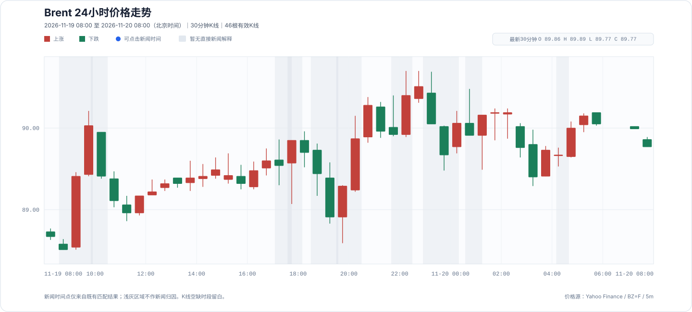

# 金十新闻事件 + Brent市场反应滚动日报（20261120 08:00）

## 今日重点（Executive Summary）

- Brent：最新价89.77，24小时涨跌幅+1.17%，区间最高90.70、最低88.51。
- 价格归因：本窗口有11段显著价格异动尚无正式新闻解释。
- 首页重大事项：伊朗革命卫队：两艘违规的超大型油轮在霍尔木兹海峡未经授权航道行驶时，触雷发生爆炸。
- 特朗普表态：白宫下令评估多套军事方案及伊朗报复选项，特朗普称明年1月1日后“拭目以待” 特朗普据悉仍在考虑美以联手空袭伊朗，白宫下令五角大楼、情报部门推演方案，重点评估能否避免伊朗打击海湾油气设施。
- ISW研判：胡塞武装很可能正试图夺取也门政府在哈拉兹山附近有利地形上的阵地，以推进对拉赫季省的控制，并为围困和夺取亚丁市创造条件。

- 时间线复核后，11段异动仍未形成可靠的正式新闻归因；存在一处15分钟行情缺口，详见复核与审计。

## 今日 Brent 价格预测

- 预测日期：2026-11-20
- 当前 Brent 收盘价：90.00 美元/桶
- 选用模型：ARIMA
- 预测价格：90.02 美元/桶
- 预测涨跌幅：+0.02%
- 预测方向：上涨
- 历史 Direction Accuracy：47.70%
- 历史 Balanced Accuracy：31.95%
- 历史 MAE / RMSE：0.0222 / 0.0312
- 历史 OOS 样本：283
- 数据边界：仅使用历史价格数据，不使用任何新闻或非价格输入。

> Price Layer 当前选择 ARIMA 作为历史样本外表现最好的模型，预测下一交易日 Brent 小幅上涨，预测价格为 90.02 美元/桶，预测涨跌幅约 +0.02%。历史方向准确率47.70%、平衡准确率31.95%，本期预测幅度仅+0.02%，方向信号很弱，不据此形成高置信度交易结论。

统计窗口：2026-11-19 08:00 至 2026-11-20 08:00（Asia/Shanghai）
新闻范围：2026-11-19 08:00 至 2026-11-20 08:00（不含截止时刻）
数据来源：金十数据快讯｜Yahoo Finance / BZ=F / 5m｜金十数据特朗普专栏｜ISW Iran Update（仅用于后续监测）

## 标的信息

- instrument_name: Brent Crude Oil Last Day Financ
- source: Yahoo Finance
- ticker: BZ=F
- contract_month: 
- contract_type: Yahoo Finance BZ=F

## 数据覆盖范围

- 价格统计窗口：2026-11-19 08:00:00 至 2026-11-20 08:00:00 北京时间（截止时刻不含）
- 实际新闻覆盖：2026-11-19 08:01:23 至 2026-11-20 07:59:54 北京时间
- 实际价格覆盖：2026-11-19 08:00:00 至 2026-11-20 07:55:00 北京时间
- Brent 5分钟K线数量：269
- 重复时间戳数量：0
- 时间戳是否有序：是
- 大于5分钟的K线缺口数量：5；最大缺口：75分钟
- 有效交易时段大于10分钟缺口数量：1；最大有效缺口：15分钟
- 正常维护休市缺口数量：1
- 是否使用部分缓存：否
- 数据状态：FORMAL；原因：Brent统计窗口内存在1处大于10分钟的有效交易时段K线缺口：2026-11-19 08:10至2026-11-19 08:25（15分钟）。

## 本窗口Brent表现

| 最新价 | 24小时涨跌幅 | 区间最高价 | 区间最低价 |
| ---: | ---: | ---: | ---: |
| 89.77 | +1.17% | 90.70 | 88.51 |

30分钟K线，红色表示上涨、绿色表示下跌；蓝色时间点是已匹配新闻，浅灰区域表示暂无直接新闻解释。

## 本窗口Brent价格异动复盘

本窗口存在符合阈值的Brent价格异动，但金十反查未找到满足供给端硬门槛的新闻，已全部列入下一部分。

## 价格异动但新闻解释不足

本窗口有11段显著价格异动尚无正式新闻解释。

### 北京时间 08:35–09:55｜Brent上涨 +1.63%

**油价反应：**
5分钟：+0.01%｜15分钟：N/A｜30分钟：+0.70%｜60分钟：+1.05%｜本轮累计：+1.63%

**说明：**
未找到足以可靠解释该段波动的金十新闻；以下仅为同期相关背景，不作价格归因。

**相关背景（未作价格归因）：**
1. 新闻摘要：根据卫星数据和船舶追踪信息，过去一周经由霍尔木兹海峡向外航行的液化天然气运输船数量似乎有所下降；这表明在经历了一连串袭击事件后，船东们变得更加谨慎。综合彭博、Kpler的数据以及卫星图像显示，在截至周二的一周内，仅有约两艘船只通...
   发布时间：2026-11-19 09:47 北京时间
   原文链接：https://flash.jin10.com/detail/20261119094717518800
   时间关系：同期发生
   信息新鲜度：新增事实
   传导路径：直接涉及原油/能源供应、运输、制裁、库存或产量变化
   对应价格异动：北京时间 08:35–09:55
   归因判断：相关背景，未作价格归因
   置信度：低

**可能原因：**
美元、美债、美国市场开盘、资金流、技术交易、外盘消息、新闻抓取缺口或非金十来源事件。

归因判断：暂无法确认
置信度：低

### 北京时间 09:50–10:30｜Brent下跌 -0.90%

**油价反应：**
5分钟：-0.17%｜15分钟：-0.64%｜30分钟：-0.82%｜60分钟：-1.02%｜本轮累计：-0.90%

**说明：**
暂未找到符合条件的金十新闻，原因暂无法确认，需人工继续核查。

**可能原因：**
美元、美债、美国市场开盘、资金流、技术交易、外盘消息、新闻抓取缺口或非金十来源事件。

归因判断：暂无法确认
置信度：低

### 北京时间 17:05–17:45｜Brent下跌 -0.40%

**油价反应：**
5分钟：+0.20%｜15分钟：-0.03%｜30分钟：-0.50%｜60分钟：+0.26%｜本轮累计：-0.40%

**说明：**
未找到足以可靠解释该段波动的金十新闻；以下仅为同期相关背景，不作价格归因。

**相关背景（未作价格归因）：**
1. 新闻摘要：欧洲天然气价格在前一交易日下跌后，于早盘交易中反弹。基准荷兰TTF天然气期货今日上涨3.7%，报每兆瓦时83.80欧元。澳新银行分析师表示，近期天然气价格下跌主要受到美国液化天然气（LNG）出口量增加，以及部分亚洲主要进口国需求...
   发布时间：2026-11-19 16:58 北京时间
   原文链接：https://flash.jin10.com/detail/20261119165859204800
   时间关系：新闻先于价格
   信息新鲜度：新增事实
   传导路径：直接涉及原油/能源供应、运输、制裁、库存或产量变化
   对应价格异动：北京时间 17:05–17:45
   归因判断：相关背景，未作价格归因
   置信度：低

2. 新闻摘要：伊朗革命卫队：两艘违规的超大型油轮在霍尔木兹海峡未经授权航道行驶时，触雷发生爆炸。
   发布时间：2026-11-19 17:56 北京时间
   原文链接：https://flash.jin10.com/detail/20261119175635497800
   时间关系：价格先于新闻
   信息新鲜度：新增事实
   传导路径：直接涉及霍尔木兹能源运输风险
   对应价格异动：北京时间 17:05–17:45
   归因判断：相关背景，未作价格归因
   置信度：低

**可能原因：**
美元、美债、美国市场开盘、资金流、技术交易、外盘消息、新闻抓取缺口或非金十来源事件。

归因判断：暂无法确认
置信度：低

### 北京时间 17:35–18:10｜Brent上涨 +0.76%

**油价反应：**
5分钟：+0.16%｜15分钟：+0.29%｜30分钟：+0.76%｜60分钟：+0.71%｜本轮累计：+0.76%

**说明：**
暂未找到符合条件的金十新闻，原因暂无法确认，需人工继续核查。

**可能原因：**
美元、美债、美国市场开盘、资金流、技术交易、外盘消息、新闻抓取缺口或非金十来源事件。

归因判断：暂无法确认
置信度：低

### 北京时间 18:30–19:35｜Brent下跌 -1.07%

**油价反应：**
5分钟：+0.03%｜15分钟：-0.51%｜30分钟：-0.57%｜60分钟：-1.13%｜本轮累计：-1.07%

**说明：**
暂未找到符合条件的金十新闻，原因暂无法确认，需人工继续核查。

**可能原因：**
美元、美债、美国市场开盘、资金流、技术交易、外盘消息、新闻抓取缺口或非金十来源事件。

归因判断：暂无法确认
置信度：低

### 北京时间 19:30–20:30｜Brent上涨 +1.53%

**油价反应：**
5分钟：+0.06%｜15分钟：+0.23%｜30分钟：+0.96%｜60分钟：+1.53%｜本轮累计：+1.53%

**说明：**
未找到足以可靠解释该段波动的金十新闻；以下仅为同期相关背景，不作价格归因。

**相关背景（未作价格归因）：**
1. 新闻摘要：俄罗斯总统普京在新闻发布会上表示，希望我们与美国关系在某些方面能更有效率。在与美国的关系中，要落实协议并非易事，但特朗普政府的做法令人感到乐观。达成某种协议，即使未能完全落实，也比完全没有协议要好。我预计，恢复俄美关系的势头将会...
   发布时间：2026-11-19 20:23 北京时间
   原文链接：https://flash.jin10.com/detail/20261119202349461800
   时间关系：同期发生
   信息新鲜度：新增事实
   传导路径：直接涉及原油/能源供应、运输、制裁、库存或产量变化
   对应价格异动：北京时间 19:30–20:30
   归因判断：相关背景，未作价格归因
   置信度：低

**可能原因：**
美元、美债、美国市场开盘、资金流、技术交易、外盘消息、新闻抓取缺口或非金十来源事件。

归因判断：暂无法确认
置信度：低

### 北京时间 21:40–22:30｜Brent上涨 +0.62%

**油价反应：**
5分钟：+0.07%｜15分钟：-0.13%｜30分钟：+0.63%｜60分钟：+0.53%｜本轮累计：+0.62%

**说明：**
暂未找到符合条件的金十新闻，原因暂无法确认，需人工继续核查。

**可能原因：**
美元、美债、美国市场开盘、资金流、技术交易、外盘消息、新闻抓取缺口或非金十来源事件。

归因判断：暂无法确认
置信度：低

### 北京时间 22:55–23:50｜Brent下跌 -1.01%

**油价反应：**
5分钟：-0.03%｜15分钟：+0.04%｜30分钟：-0.51%｜60分钟：-0.93%｜本轮累计：-1.01%

**说明：**
暂未找到符合条件的金十新闻，原因暂无法确认，需人工继续核查。

**可能原因：**
美元、美债、美国市场开盘、资金流、技术交易、外盘消息、新闻抓取缺口或非金十来源事件。

归因判断：暂无法确认
置信度：低

### 北京时间 23:50–00:20｜Brent上涨 +0.55%

**油价反应：**
5分钟：+0.08%｜15分钟：+0.46%｜30分钟：+0.55%｜60分钟：+0.59%｜本轮累计：+0.55%

**说明：**
暂未找到符合条件的金十新闻，原因暂无法确认，需人工继续核查。

**可能原因：**
美元、美债、美国市场开盘、资金流、技术交易、外盘消息、新闻抓取缺口或非金十来源事件。

归因判断：暂无法确认
置信度：低

### 北京时间 00:35–01:15｜Brent下跌 -0.53%

**油价反应：**
5分钟：+0.06%｜15分钟：-0.19%｜30分钟：-0.55%｜60分钟：-0.22%｜本轮累计：-0.53%

**说明：**
暂未找到符合条件的金十新闻，原因暂无法确认，需人工继续核查。

**可能原因：**
美元、美债、美国市场开盘、资金流、技术交易、外盘消息、新闻抓取缺口或非金十来源事件。

归因判断：暂无法确认
置信度：低

### 北京时间 04:10–04:40｜Brent上涨 +0.51%

**油价反应：**
5分钟：+0.20%｜15分钟：+0.16%｜30分钟：+0.51%｜60分钟：+0.60%｜本轮累计：+0.51%

**说明：**
暂未找到符合条件的金十新闻，原因暂无法确认，需人工继续核查。

**可能原因：**
美元、美债、美国市场开盘、资金流、技术交易、外盘消息、新闻抓取缺口或非金十来源事件。

归因判断：暂无法确认
置信度：低

## 未充分定价的重大风险

- 2026-11-19 08:40 美国总统特朗普：我们完全控制霍尔木兹海峡，上周该地区的商业活动和石油出口创下纪录。（出口/装船/港口节奏）：命中重大主题：原油出口、港口装船、制裁或OPEC/OPEC+产量政策；本窗口未成为独立价格异动核心驱动，后续继续看是否出现实物流或官方确认。原文链接：https://flash.jin10.com/detail/20261119084057898800
- 2026-11-19 09:47 袭击增多 霍尔木兹海峡LNG出口似乎有所放缓（LNG供应中断/能源安全）：命中重大主题：LNG出口中断、紧急采购或能源安全；本窗口未成为独立价格异动核心驱动，后续继续看是否出现实物流或官方确认。原文链接：https://flash.jin10.com/detail/20261119094717518800
- 2026-11-20 05:59 金十数据整理：中东局势跟踪（11月20日）（LNG供应中断/能源安全）：命中重大主题：霍尔木兹通行/护航/封锁/油轮运行风险；本窗口未成为独立价格异动核心驱动，后续继续看是否出现实物流或官方确认。原文链接：https://flash.jin10.com/detail/20261120055922715800
- 2026-11-19 17:56 伊朗革命卫队：两艘违规的超大型油轮在霍尔木兹海峡未经授权航道行驶时，触雷发生爆炸。（霍尔木兹航运风险）：命中重大主题：霍尔木兹通行/护航/封锁/油轮运行风险；本窗口未成为独立价格异动核心驱动，后续继续看是否出现实物流或官方确认。原文链接：https://flash.jin10.com/detail/20261119175635497800
- 2026-11-20 02:50 伊朗军方：霍尔木兹海峡东部一艘违规油轮起火（霍尔木兹航运风险）：命中重大主题：霍尔木兹通行/护航/封锁/油轮运行风险；本窗口未成为独立价格异动核心驱动，后续继续看是否出现实物流或官方确认。原文链接：https://flash.jin10.com/detail/20261120025032016800

## 首页重大事项（未匹配显著异动）

- 2026-11-19 17:56｜伊朗革命卫队：两艘违规的超大型油轮在霍尔木兹海峡未经授权航道行驶时，触雷发生爆炸。
  原文链接：https://flash.jin10.com/detail/20261119175635497800
  说明：该事项尚未匹配显著Brent异动，仅作为未定价重大事项展示，不构成正式价格归因。

## 人工时间线与价格口径复核

- 08:35–09:55上涨先于09:47的LNG出口放缓报道。运输风险可能强化后段风险溢价，但不能解释起涨，且LNG对原油的传导属于间接渠道；置信度低。
- 17:56油轮触雷消息晚于17:05–17:45下跌，且运输受阻通常偏多，不能用于解释该下跌。17:35–18:10反弹也已先开始，只能将该消息列为可能的后续强化线索；置信度低。
- 19:30–20:30上涨先于20:23俄美关系表态，且该表态未提供直接新增原油供应事实，保留解释不足。21:38军事方案报道早于21:40–22:30上涨，海湾油气设施风险存在偏多传导可能，但未证明实际减供，不升级为确定归因；置信度低。
- 09:50–10:30、18:30–19:35、22:55–23:50、00:35–01:15下跌，以及23:50–00:20、04:10–04:40上涨，现有新闻未提供足够明确的先行触发证据，全部保留原因未确认；置信度低。
- 数据限制：08:10–08:25存在15分钟有效交易时段K线缺口；5/124条分析事件价格观察不完整。窗口末价89.77与Price Layer上一完整交易日收盘90.00属于不同统计时点，不混作同一收盘。

## 市场主要驱动与下一时段判断

### 本窗口市场主线

Brent本窗口整体偏强，窗口涨跌幅为+1.17%；识别到11段独立价格异动（08:35–09:55涨1.63%；09:50–10:30跌0.90%；17:05–17:45跌0.40%；17:35–18:10涨0.76%；18:30–19:35跌1.07%；19:30–20:30涨1.53%；21:40–22:30涨0.62%；22:55–23:50跌1.01%；23:50–00:20涨0.55%；00:35–01:15跌0.53%；04:10–04:40涨0.51%），但未找到足够明确、及时且新增的金十新闻驱动，市场主线置信度为低。

### 核心驱动窗口

暂无足够明确的核心新闻驱动；请优先查看“价格异动但新闻解释不足”。

### 新闻与价格是否一致

部分Brent异动附近虽有能源新闻，但新鲜度、时间顺序或Brent直接传导证据不足，不能把时间接近写成因果关系。

### 下一时段判断

- 基准情景：若没有新的实物供应、航运或政策证据，Brent更可能围绕库存、供应和地缘消息做区间波动。
- 偏多触发：确认油轮滞留、护航升级、港口装船中断、制裁加码、出口受阻、LNG/原油供应中断或OPEC+意外减产。
- 偏空触发：海峡通行恢复、出口恢复、军事局势降温、OSP下调扩大、库存增加或炼厂开工回落。
- 重点验证：AIS船位、港口装船、官方制裁或豁免文件、海军护航安排、OPEC+官方表态、EIA/API库存。
- 当前未充分定价风险：运费、保险费、船东风险偏好和装船排队可能滞后于新闻反映。

## 特朗普相关言论

### 2026-11-19 21:38:25｜伊朗、战争与军事行动

白宫下令评估多套军事方案及伊朗报复选项，特朗普称明年1月1日后“拭目以待” 特朗普据悉仍在考虑美以联手空袭伊朗，白宫下令五角大楼、情报部门推演方案，重点评估能否避免伊朗打击海湾油气设施。

- 金十来源：[白宫下令评估多套军事方案及伊朗报复选项，特朗普称明年1月1日后“拭目以待”](https://xnews.jin10.com/webapp/details.html?id=235600&type=news&data_type=0)

## ISW Iran Update

- 更新时间：纽约时间 2026-11-18 21:47 / 北京时间 2026-11-19 10:47
- 标题：Iran Update, November 18, 2026
- 原文链接：https://understandingwar.org/research/middle-east/iran-update-november-18-2026/

**Key Takeaways：**

1. 胡塞武装很可能正试图夺取也门政府在哈拉兹山附近有利地形上的阵地，以推进对拉赫季省的控制，并为围困和夺取亚丁市创造条件。
2. 其他要点：也门政府未能守住哈拉兹山附近一处易守难攻的阵地，说明政府阵营部队无力在拉赫季省南部组织有效防御。
3. 伊朗几乎每天都在袭击该地区的美军基础设施，以回应美国持续打击霍尔木兹海峡附近的伊朗军事设施。
4. 伊朗也持续袭击海峡内的商船，并声称船舶在航道内触雷，意在削弱美国保障航行自由的努力。

## 今日关注什么

- 霍尔木兹海峡是否继续通行，以及是否出现收费、封锁或护航安排变化；
- 油轮、港口和AIS船位变化，包括停航、绕航、遭袭、排队和装船节奏；
- 制裁、豁免和出口政策是否出现新的官方文件或执行变化；
- OPEC+及主要产油国政策是否出现产量、配额或官方售价调整；
- 地区冲突是否升级或缓和，重点跟踪军事行动与关键设施安全；
- EIA/API库存或其他重要供需数据是否改变短线供需判断；
- 当天ISW Iran Update最值得跟踪的事项：胡塞武装很可能正试图夺取也门政府在哈拉兹山附近有利地形上的阵地，以推进对拉赫季省的控制，并为围困和夺取亚丁市创造条件。

[查看完整 Audit →](Jin10_Brent_Rolling_Audit_20261120_0800.html)
