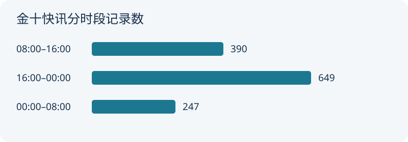

# 金十 Brent 原油新闻日报 2026年11月24日

[交互式滚动日报 HTML](index.html) · 下载后在浏览器中打开。

**新闻覆盖状态：COMPLETE（完整覆盖）**

窗口为 11 月 23 日 08:00（含）至 11 月 24 日 08:00（不含），以下时间均为北京时间，与新加坡时间相同。

金十公开快讯 1,286 条，回溯 65 页。三段记录数为 390 / 649 / 247，实际首尾为 11-23 08:01:22 至 11-24 07:57:35。

## 最重要进展

### 利比亚沙拉拉输油管道恢复输送

利比亚国家石油公司称，连接沙拉拉油田与沿海扎维耶的输油管道一度关闭，原油日产量减少约35万桶。该公司董事长随后表示管道已开放，原油恢复输送并开始流入扎维耶的储罐。

[11-23 13:34:01 金十原文](https://flash.jin10.com/detail/20261123133401298800) · [11-23 14:53:48 金十原文](https://xnews.jin10.com/details/235808) · [11-23 18:21:06 金十原文](https://flash.jin10.com/detail/20261123182106763800) · [11-23 18:53:28 金十原文](https://flash.jin10.com/detail/20261123185328132800)

### 伊朗方面称霍尔木兹海峡三艘油轮发生爆炸

金十转引伊朗伊斯兰革命卫队海军说法称，三艘油轮在海峡发生爆炸。两条快讯指向同一事件，船舶身份、损失与航道影响仍待其他来源核实。

[11-24 05:06:10 金十原文](https://flash.jin10.com/detail/20261124050610842800) · [11-24 05:29:20 金十原文](https://flash.jin10.com/detail/20261124052920781800)

### 第三方船舶监测显示富查伊拉石油流入减弱

金十引述 QuantCube Technology 数据称，流入阿联酋富查伊拉的石油量较10月峰值低67%。该监测使用港口船舶流入作为部分海峡运输活动的替代指标。

[11-23 14:15:13 金十原文](https://flash.jin10.com/detail/20261123141513813800)

## 供应与生产

### 利比亚沙拉拉输油管道恢复输送

利比亚国家石油公司称，连接沙拉拉油田与沿海扎维耶的输油管道一度关闭，原油日产量减少约35万桶。该公司董事长随后表示管道已开放，原油恢复输送并开始流入扎维耶的储罐。

**可能影响** 恢复输送有助于缓解中断，但实际回补量取决于油田产量和装船进度。

[11-23 13:34:01 金十原文](https://flash.jin10.com/detail/20261123133401298800) · [11-23 14:53:48 金十原文](https://xnews.jin10.com/details/235808) · [11-23 18:21:06 金十原文](https://flash.jin10.com/detail/20261123182106763800) · [11-23 18:53:28 金十原文](https://flash.jin10.com/detail/20261123185328132800)

## 航运与出口

### 伊朗方面称霍尔木兹海峡三艘油轮发生爆炸

金十转引伊朗伊斯兰革命卫队海军说法称，三艘油轮在海峡发生爆炸。两条快讯指向同一事件，船舶身份、损失与航道影响仍待其他来源核实。

**可能影响** 若船损或运输受阻得到确认，运费、保费和交付时间可能上升。

[11-24 05:06:10 金十原文](https://flash.jin10.com/detail/20261124050610842800) · [11-24 05:29:20 金十原文](https://flash.jin10.com/detail/20261124052920781800)

### 第三方船舶监测显示富查伊拉石油流入减弱

金十引述 QuantCube Technology 数据称，流入阿联酋富查伊拉的石油量较10月峰值低67%。该监测使用港口船舶流入作为部分海峡运输活动的替代指标。

**可能影响** 可跟踪转运活动变化。比较基准为10月峰值，结果只覆盖该指标。

[11-23 14:15:13 金十原文](https://flash.jin10.com/detail/20261123141513813800)

### 美国官员称上周霍尔木兹海峡运输1.08亿桶石油

金十转引沙特媒体哈达斯报道，美国官员表示上周经霍尔木兹海峡运输1.08亿桶石油。

**可能影响** 这项总量与富查伊拉港的单港指标口径不同，需各自与可比船运序列核对。

[11-24 02:47:30 金十原文](https://flash.jin10.com/detail/20261124024730702800)

## 炼油与基础设施

### 俄罗斯罗斯托夫州一座炼油厂在袭击后停运

当地州长表示新沙赫京斯克炼油厂在袭击后暂停运作，乌克兰军方随后称袭击了该厂。金十报道称其日加工能力为11万桶，实际停产规模和恢复时间尚无明确数据。

**可能影响** 停运若持续，可能影响当地成品油供应和原油加工量。

[11-23 18:09:13 金十原文](https://flash.jin10.com/detail/20261123180913657800) · [11-23 19:43:23 金十原文](https://flash.jin10.com/detail/20261123194323747800) · [11-23 19:48:46 金十原文](https://flash.jin10.com/detail/20261123194846084800)

## 库存

### 美国战略石油储备降至2.735亿桶

金十援引美国能源部数据称，上周美国战略石油储备原油库存降至2.735亿桶，为1982年8月以来最低。近期库存减少与此前达成的储备释放安排有关。

**可能影响** 储备释放可暂时补充原油供应，同时降低未来可动用的政策缓冲。

[11-23 21:34:59 金十原文](https://flash.jin10.com/detail/20261123213459908800)

## 制裁与政策

### 美国财政部制裁伊朗影子银行网络

美国财政部称，对二十多家伊朗外币兑换所、掩护公司和相关个人实施制裁，针对为伊朗转移境外收入提供支持的金融网络。

**可能影响** 措施可能增加出口款结算和合规成本，实际装运变化仍需后续数据确认。

[11-24 03:46:11 金十原文](https://flash.jin10.com/detail/20261124034611593800)

## 特朗普重要表态

专题本期无符合规则的表态。

## 本期核验范围

本期未筛得值得单独列报的原油需求实测或 OPEC+ 新决定。特朗普专栏窗口内核对 4 条，项目规则未筛得新的合格表态。部分常规市场快讯和他方对旧表态的回应留在内部审计范围。

## 下一时段待确认

- 核对沙拉拉油田恢复产量与扎维耶装船，并区分名义产能和实际出货。
- 跟踪霍尔木兹油轮事件的独立通报、船舶通行和保险报价，用一致口径复核出口量。
- 分别跟踪美国战略储备释放与商业原油、油品库存变化。
- 核对涉伊制裁执行范围、付款渠道变化和俄罗斯炼油厂复产进展。

## 分时段快讯覆盖

