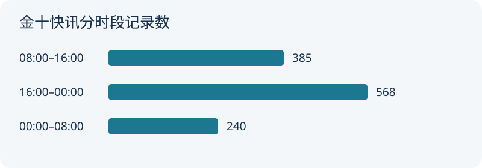

# 金十 Brent 原油新闻日报 2026年11月25日

[交互式滚动日报 HTML](index.html) · 下载后在浏览器中打开。

**新闻覆盖状态：COMPLETE（完整覆盖）**

窗口为 11 月 24 日 08:00（含）至 11 月 25 日 08:00（不含），以下时间均为北京时间，与新加坡时间相同。

金十公开快讯 1,193 条，回溯 60 页。三段记录数为 385 / 568 / 240，实际首尾为 11-24 08:00:35 至 11-25 07:56:13。

## 最重要进展

### 美国 API 原油库存增幅低于预期

金十公布，截至 11 月 20 日当周，API 美国原油库存增加 12.6 万桶，低于预期的 90 万桶。库欣原油库存减少 66.6 万桶，汽油库存减少 4.7 万桶，精炼油库存增加 164.7 万桶。

[11-25 05:33:40 金十原文](https://flash.jin10.com/detail/20261125053340344800) · [11-25 05:33:49 金十原文](https://flash.jin10.com/detail/20261125053349801800) · [11-25 05:33:58 金十原文](https://flash.jin10.com/detail/20261125053358049800) · [11-25 05:35:03 金十原文](https://flash.jin10.com/detail/20261125053503951800)

### 伊拉克拒绝接受 OPEC+ 委托作出的产能评估

金十援引知情人士称，伊拉克拒绝接受外部顾问作出的石油产能评估。争议可能进入本周末的 OPEC+ 产量目标磋商，窗口内尚未见到新配额决定。

[11-25 01:05:22 金十原文](https://flash.jin10.com/detail/20261125010522040800) · [11-25 01:48:29 金十原文](https://flash.jin10.com/detail/20261125014829925800)

### 霍尔木兹海峡出现新的油轮遇袭通报

金十转述伊朗官方媒体称两艘油轮触雷起火，另引塔斯尼姆通讯社报道一起油轮爆炸。英国海事贸易组织另通报，11 月 22 日有一艘油轮东行穿越海峡时遇袭。各报道所涉船只尚待比对，数量不作累加。

[11-24 17:01:06 金十原文](https://flash.jin10.com/detail/20261124170106869800) · [11-24 18:54:34 金十原文](https://flash.jin10.com/detail/20261124185434255800) · [11-25 00:31:22 金十原文](https://flash.jin10.com/detail/20261125003122291800)

## 库存

### 美国 API 原油库存增幅低于预期

金十公布，截至 11 月 20 日当周，API 美国原油库存增加 12.6 万桶，低于预期的 90 万桶。库欣原油库存减少 66.6 万桶，汽油库存减少 4.7 万桶，精炼油库存增加 164.7 万桶。

**可能影响** 整体原油累库幅度低于预期，汽油和精炼油库存则表现分化。仍需用 EIA 数据核对。

[11-25 05:33:40 金十原文](https://flash.jin10.com/detail/20261125053340344800) · [11-25 05:33:49 金十原文](https://flash.jin10.com/detail/20261125053349801800) · [11-25 05:33:58 金十原文](https://flash.jin10.com/detail/20261125053358049800) · [11-25 05:35:03 金十原文](https://flash.jin10.com/detail/20261125053503951800)

## 供应与产量政策

### 伊拉克拒绝接受 OPEC+ 委托作出的产能评估

金十援引知情人士称，伊拉克拒绝接受外部顾问作出的石油产能评估。争议可能进入本周末的 OPEC+ 产量目标磋商，窗口内尚未见到新配额决定。

**可能影响** 产能认定影响配额谈判。评估分歧对实际供给的影响仍需等会议结果和执行情况。

[11-25 01:05:22 金十原文](https://flash.jin10.com/detail/20261125010522040800) · [11-25 01:48:29 金十原文](https://flash.jin10.com/detail/20261125014829925800)

## 航运与出口

### 霍尔木兹海峡出现新的油轮遇袭通报

金十转述伊朗官方媒体称两艘油轮触雷起火，另引塔斯尼姆通讯社报道一起油轮爆炸。英国海事贸易组织另通报，11 月 22 日有一艘油轮东行穿越海峡时遇袭。各报道所涉船只尚待比对，数量不作累加。

**可能影响** 若遇袭或通行受阻获得独立确认，航运保费、交付时效和出口量可能受到影响。

[11-24 17:01:06 金十原文](https://flash.jin10.com/detail/20261124170106869800) · [11-24 18:54:34 金十原文](https://flash.jin10.com/detail/20261124185434255800) · [11-25 00:31:22 金十原文](https://flash.jin10.com/detail/20261125003122291800)

### 沙特预算声明称石油出口回升

据金十转述，沙特财政部周二发布的预算声明将 2026 年经济萎缩幅度预期从 3.6% 下调至 2.1%，并指石油出口增加缓解了此前袭击造成的冲击。

**可能影响** 可以继续核对实际装船与出口节奏，以判断回升能持续多久。

[11-24 22:03:21 金十原文](https://flash.jin10.com/detail/20261124220321585800)

### 媒体称美国调查能源运输船网络事件

金十转述美国媒体消息称，部分能源运输船收到威胁，美国正调查相关网络事件及其来源。船舶受影响范围和归因仍未独立核实。

**可能影响** 如运营受到持续影响，需关注航运和保险成本，以及实际装卸是否延迟。

[11-24 10:32:35 金十原文](https://xnews.jin10.com/details/235891)

## 制裁与政策

### 英国宣布针对胡塞武装的新制裁

据金十报道，英国宣布新制裁，并对四名胡塞领导人采取资产冻结和旅行禁令。

**可能影响** 红海通航压力仍需根据海事安全通告、绕航和实际船流变化判断。

[11-24 19:15:13 金十原文](https://flash.jin10.com/detail/20261124191513628801) · [11-24 19:20:31 金十原文](https://flash.jin10.com/detail/20261124192031897800) · [11-24 20:53:55 金十原文](https://xnews.jin10.com/details/235974)

## 特朗普重要表态

专题本期无符合规则的表态。

## 本期核验范围

本期未筛得具备明确统计口径、适合单列的原油需求实测。特朗普专栏有 9 条处于新闻窗口，按项目规则未筛得新的合格直接表态。

## 下一时段待确认

- 等待 EIA 原油和油品库存，分别核对商业原油、库欣和成品油库存变化。
- 跟踪 OPEC+ 对伊拉克产能评估的处理和产量目标决定。
- 比对霍尔木兹遇袭通报、船舶身份和通行数据，并核对沙特装船。
- 跟踪英国制裁执行范围及红海、霍尔木兹航线保险和绕航变化。

## 分时段快讯覆盖

