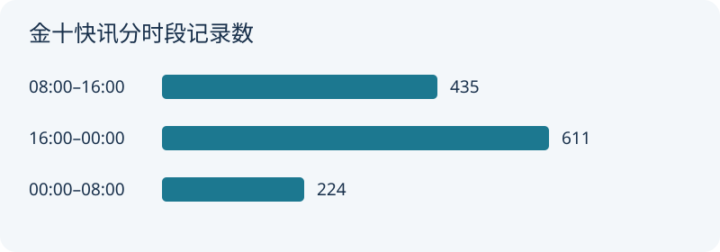

# 金十 Brent 原油新闻日报 2026年11月26日

[交互式滚动日报 HTML](index.html) · 下载后在浏览器中打开。

**新闻覆盖状态：COMPLETE（完整覆盖）**

窗口为 11 月 25 日 08:00（含）至 11 月 26 日 08:00（不含），以下时间均为北京时间，与新加坡时间相同。

金十公开快讯 1,270 条，回溯 64 页。三段记录数为 435 / 611 / 224，实际首尾为 11-25 08:00:49 至 11-26 07:52:35。

## 最重要进展

### EIA 商业原油库存增幅低于预期

金十援引 EIA 数据称，截至 11 月 20 日当周，美国商业原油库存增加 110.9 万桶，低于预期的 150.6 万桶。库欣原油库存减少 53.4 万桶，汽油库存增加 173.3 万桶，精炼油库存增加 71.5 万桶。美国油品四周平均供应量同比增加 2.22%。

[11-25 23:30:03 金十原文](https://flash.jin10.com/detail/20261125233003366800) · [11-25 23:30:03 金十原文](https://flash.jin10.com/detail/20261125233003387800) · [11-25 23:30:03 金十原文](https://flash.jin10.com/detail/20261125233003419800) · [11-25 23:30:03 金十原文](https://flash.jin10.com/detail/20261125233003675800) · [11-25 23:31:13 金十原文](https://flash.jin10.com/detail/20261125233113583800)

### 阿联酋限制部分油轮进入油气出口设施附近水域

据金十转述通告，阿联酋对部分港口和装货设施附近水域实施船舶进出限制。前往指定设施或开展获准业务的船舶属于例外。

[11-25 23:21:19 金十原文](https://flash.jin10.com/detail/20261125232119773800)

### OPEC+ 产能评估分歧延续

金十报道伊拉克寻求上调初步产能评估，并援引消息人士称哈萨克斯坦也希望获得更高配额。俄罗斯副总理诺瓦克表示，计划在年底前完成相关评估。各方表态尚未形成新的产量配额决定。

[11-25 08:47:10 金十原文](https://xnews.jin10.com/details/235987) · [11-25 19:18:57 金十原文](https://flash.jin10.com/detail/20261125191857627800) · [11-25 21:15:53 金十原文](https://flash.jin10.com/detail/20261125211553258800)

## 库存与需求

### EIA 商业原油库存增幅低于预期

金十援引 EIA 数据称，截至 11 月 20 日当周，美国商业原油库存增加 110.9 万桶，低于预期的 150.6 万桶。库欣原油库存减少 53.4 万桶，汽油库存增加 173.3 万桶，精炼油库存增加 71.5 万桶。美国油品四周平均供应量同比增加 2.22%。

**可能影响** 商业原油仍在累库，增幅小于预期。库欣与成品油变化分化，油品供应量可作为需求观察指标。

[11-25 23:30:03 金十原文](https://flash.jin10.com/detail/20261125233003366800) · [11-25 23:30:03 金十原文](https://flash.jin10.com/detail/20261125233003387800) · [11-25 23:30:03 金十原文](https://flash.jin10.com/detail/20261125233003419800) · [11-25 23:30:03 金十原文](https://flash.jin10.com/detail/20261125233003675800) · [11-25 23:31:13 金十原文](https://flash.jin10.com/detail/20261125233113583800)

## 航运与出口

### 阿联酋限制部分油轮进入油气出口设施附近水域

据金十转述通告，阿联酋对部分港口和装货设施附近水域实施船舶进出限制。前往指定设施或开展获准业务的船舶属于例外。

**可能影响** 需核对实际执行范围、装船和船期，才能判断出口交付受影响的程度。

[11-25 23:21:19 金十原文](https://flash.jin10.com/detail/20261125232119773800)

## 供应与产量政策

### OPEC+ 产能评估分歧延续

金十报道伊拉克寻求上调初步产能评估，并援引消息人士称哈萨克斯坦也希望获得更高配额。俄罗斯副总理诺瓦克表示，计划在年底前完成相关评估。各方表态尚未形成新的产量配额决定。

**可能影响** 产能认定会影响配额谈判，后续要分别核对正式配额和实际产量。

[11-25 08:47:10 金十原文](https://xnews.jin10.com/details/235987) · [11-25 19:18:57 金十原文](https://flash.jin10.com/detail/20261125191857627800) · [11-25 21:15:53 金十原文](https://flash.jin10.com/detail/20261125211553258800)

### Equinor 在临时停产后下调全年产量增长指引

金十发布的公司消息显示，Equinor 将 2026 年产量增长指引从 4% 下调至约 3%。

**可能影响** 指引调整反映公司对全年供给的重新评估，短期交付还取决于复产进度。

[11-26 00:16:34 金十原文](https://flash.jin10.com/detail/20261126001634104800)

## 航运安全

### 伊朗媒体称霍尔木兹海峡两艘油轮发生爆炸

金十转引伊朗塔斯尼姆通讯社称，霍尔木兹海峡发生涉及两艘油轮的爆炸事件。船舶身份、实际损害及与此前通报是否重叠仍待独立核实。

**可能影响** 关注航道通行告示、保险成本和实际装船。

[11-25 12:42:12 金十原文](https://flash.jin10.com/detail/20261125124212523800)

## 炼油与基础设施

### 胡塞武装称袭击沙特拉斯坦努拉炼油厂

金十转述胡塞武装说法称其袭击了沙特拉斯坦努拉炼油厂。本条来源未提供可独立核验的停运或损失数据。

**可能影响** 炼厂运行、装船公告及替代供应是判断能源影响的主要依据。

[11-25 15:01:45 金十原文](https://flash.jin10.com/detail/20261125150145466800)

## 制裁与资产交易

### 含美国国际开发金融公司的财团拟收购卢克石油国际资产

据金十报道，托德·博利称已与卢克石油签署拟收购其国际能源资产的协议，参与者包括美国国际开发金融公司。报道援引消息人士称，交易仍将接受美国财政部审查。

**可能影响** 资产控制权变化将取决于审查和交割结果，现阶段需跟踪资产运营及出货公告。

[11-25 23:08:56 金十原文](https://flash.jin10.com/detail/20261125230856795800)

## 特朗普公开表态（主快讯）

### 媒体转述特朗普对伊军事行动资金说法

金十转引《纽约邮报》称，特朗普表示已有资金支持对伊军事行动至明年 1 月。

**可能影响** 表态涉及资金可用时间。能源供应风险仍需结合同期政策和海事通告核实。

[11-25 08:41:41 金十原文](https://flash.jin10.com/detail/20261125084141851800)

## 特朗普重要表态

专题本期无符合规则的表态。

## 本期核验范围

特朗普专栏窗口内核对了 4 条，专栏规则未筛得合格表态。主快讯中有一条可追溯的媒体转述，已单列。

## 下一时段待确认

- 用下一期 EIA 数据核对商业原油、库欣、成品油库存和油品供应量。
- 跟踪 OPEC+ 产能评估与配额决定，区分成员诉求、会议决定和实际产量。
- 核对阿联酋限制范围、获准通行船舶、港口装货和霍尔木兹海事通告。
- 跟踪沙特炼厂核实信息、Equinor 复产和卢克石油交易审查。

## 分时段快讯覆盖

