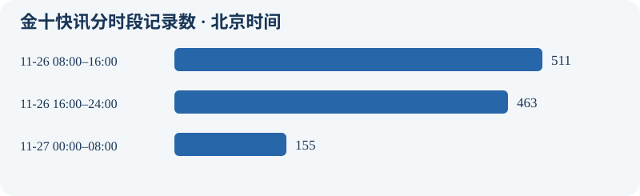

# 金十 Brent 原油新闻日报 2026年11月27日

[交互式滚动日报 HTML](index.html) · 下载后在浏览器中打开。

**新闻覆盖状态：COMPLETE（完整覆盖）**

窗口为 11 月 26 日 08:00（含）至 11 月 27 日 08:00（不含），以下时间为新加坡／北京时间。

金十公开快讯共 1,129 条，回溯 57 页，分页越过窗口起点。窗口内首尾记录为 11 月 26 日 08:01:02 和 11 月 27 日 07:59:33。

## 最重要进展

### 沙特吉赞炼厂遇袭后部分作业暂停

金十援引沙特通讯社及能源部消息称，沙特吉赞炼厂遭袭后部分作业暂停，火势已受控，造成一人死亡、多人受伤。此前沙特主导的联军将袭击归因于胡塞武装。停运范围和恢复时间仍待确认。

[11-26 22:47:26 金十原文](https://flash.jin10.com/detail/20261126224726384800) · [11-27 02:10:00 金十原文](https://flash.jin10.com/detail/20261127021000087800)

### 霍尔木兹海峡一艘出港油轮遭击中

金十转述英国海事贸易行动办公室（UKMTO）通报，阿曼海塞卜以东约 18 海里处，一艘出港油轮遭不明发射物击中。通报称船员安全，当时尚无环境影响报告。

[11-26 19:58:21 金十原文](https://flash.jin10.com/detail/20261126195821673800)

### OPEC+ 讨论延续现行产量目标

金十援引代表称，联盟先讨论将现行配额延至 1 月；随后援引知情人士报道，讨论范围可能至少延至 2027 年第一季度。周日会议前仍在磋商。

[11-26 19:28:44 金十原文](https://flash.jin10.com/detail/20261126192844530800) · [11-26 22:13:23 金十原文](https://flash.jin10.com/detail/20261126221323879800)

## 其他供应与政策进展

### 安哥拉下调 1 月原油出口安排

金十快讯称，安哥拉下调 1 月原油出口安排，降至至少 2008 年以来最低水平。该快讯未提供具体装船量。

[11-26 23:36:02 金十原文](https://flash.jin10.com/detail/20261126233602669800)

### 卡塔尔 LNG 出口回升

金十援引 Kpler 数据称，卡塔尔拉斯拉凡 11 月以来平均每日约出口 1.4 船 LNG，较上月增加约四分之一，约为冲突前的一半。

[11-26 17:05:09 金十原文](https://flash.jin10.com/detail/20261126170509283800)

### 俄罗斯炼厂起火，乌克兰称发动袭击

金十援引国际文传电讯社称，俄罗斯克拉斯诺达尔地区 Slavyansk-Eco 炼厂在无人机袭击后起火。乌克兰随后称其实施了袭击。炼厂停运时长和加工量损失尚待确认。

[11-26 21:59:53 金十原文](https://flash.jin10.com/detail/20261126215953041800) · [11-26 23:33:50 金十原文](https://flash.jin10.com/detail/20261126233350131800)

### 特朗普谈伊朗与俄乌冲突

金十引述特朗普称，美国已额外向相关地区派遣一艘航母。特朗普此前表示与北约秘书长讨论了伊朗及俄乌冲突。这些是公开表态，实际部署及能源运输变化需另行核实。

[11-26 22:20:29 金十原文](https://flash.jin10.com/detail/20261126222029569800) · [11-27 07:52:11 金十原文](https://flash.jin10.com/detail/20261127075211206800)

## 可能的能源市场影响

- **沙特吉赞炼厂遇袭后部分作业暂停。** 可能影响当地燃料供应和炼厂原油采购。原油出口装船是否受影响仍待确认。

- **霍尔木兹海峡一艘出港油轮遭击中。** 如后续出现船舶延误、改道或保险费用上涨，可能增加海湾原油的运输成本。

- **OPEC+ 讨论延续现行产量目标。** 会议结果将影响市场对明年初计划供应量的判断，实际产量仍需结合成员履约和运输情况观察。

- **安哥拉下调 1 月原油出口安排。** 若出口计划兑现，可供买家选择的部分西非现货原油可能减少。

- **卡塔尔 LNG 出口回升。** 这反映了部分海湾能源出口恢复。LNG 和原油的装船条件与目的地需分别跟踪。

- **俄罗斯炼厂起火，乌克兰称发动袭击。** 若停运持续，影响可能先体现在区域成品油供应和炼厂原油加工量。

- **特朗普谈伊朗与俄乌冲突。** 关注有关表态是否伴随航运通告、制裁规则或实际装船变化。

## Brent 行情覆盖

Yahoo Finance BZ=F 可用 K 线仅覆盖至 11 月 26 日 12:55，窗口内另有一处 15 分钟间隔。行情审计未通过截止覆盖检查，图表仅表示已有观测，本期省略全窗涨跌和新闻归因。

## 下一时段待确认

- 沙特吉赞炼厂实际停运范围、复产时间及成品油装船情况。

- 涉事油轮损伤、通航和后续 UKMTO 通告。

- OPEC+ 周日会议正式声明及西非 1 月装船表。

## 分时段快讯覆盖

- 11 月 26 日 08:00–16:00 共 511 条。

- 11 月 26 日 16:00–24:00 共 463 条。

- 11 月 27 日 00:00–08:00 共 155 条。
